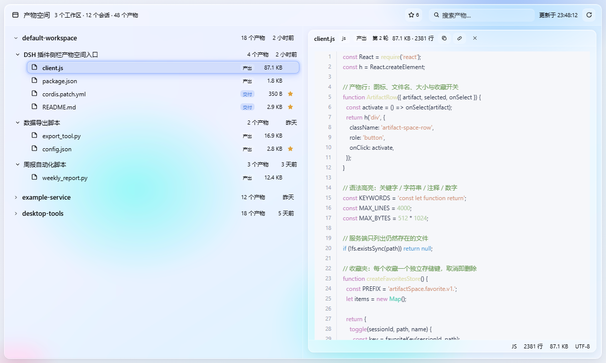

# Artifact Space (产物空间)

English | [中文](README.md)

[](https://www.npmjs.com/package/@xxjxx/artifact-space)
[](./LICENSE)
[](https://github.com/topics/dsh-plugin)

A DSH plugin that adds an **Artifact Space** (产物空间) entry to the sidebar.
It lists every workspace's final effective session artifacts — grouped by
workspace, then by session — and previews the file content when a row is
selected.



## Features

| | |
| --- | --- |
| **Glass interface** | A layered glass panel that adapts to the light and dark themes, with colored light behind it so the material actually refracts. |
| **Editor preview** | Code files open in an editor-style view: a sticky line-number gutter, syntax highlighting, and a status bar reporting language, line count, size and encoding. |
| **Multi-format rendering** | Markdown, HTML, YAML and JSON each get their own renderer, with a plain-text fallback for anything unrecognised. |
| **Three-level search** | Filter across workspaces, sessions and artifacts at once. Words separated by spaces are alternatives, so `client json` finds both `client.js` and `package.json`. |
| **Favorites** | Star the artifacts worth keeping. Favorites survive restarts, and each one leaves disk the moment you un-star it. |
| **Resizable split** | Drag the divider between the artifact list and the preview to change the widths; both sides keep a minimum. A "reset the split" button appears in the header once you have moved it. |
| **Session folding** | Sessions fold to their header. By default only the ones that fit on the first screen are open. |
| **Copy and go** | Copy a file's content or its absolute path straight from the preview header. |
| **Traceable origin** | Each artifact says whether it was *delivered* or merely *produced*, in which turn, and what the session said about it. |
| **Self-update** | A version badge lives in the panel header. When a new release appears you can download and install it right there, and roll it back in one click if it misbehaves. |

## What counts as an artifact

The Host half folds each session's own log events and keeps:

- files declared through `deliverables/presented` (kind `presented`),
- files written or edited by a successful `write`, `edit` or `str_replace_editor`
  call (kind `produced`).

Only files that still exist are listed, sessions without a surviving artifact are
dropped, and both sessions and workspaces are ordered by last activity.

## Architecture

| Half | File | Role |
| --- | --- | --- |
| Host | `index.js` | Registers the authenticated routes: `GET /api/artifact-space.rows`, `GET /api/artifact-space.read`, plus three routes for version detection and updating. |
| Host | `updater.js` | Queries the npm registry, downloads and verifies the tarball, replaces the plugin directory in place, and keeps a backup for rollback. |
| Client | `client.js` | Registers the sidebar entry (`sidebar.panellist`) and the main panel (`main` slot key `artifact-space`), and draws the version badge and update card. |

The two halves talk over an authenticated Host route registered with
`ctx.connection.fetch.register`, so no credentials leave the loopback host.

### Routes

- `GET /api/artifact-space.rows` — every workspace group with its sessions and
  artifacts.
- `GET /api/artifact-space.read?sessionId=…&path=…` — the text of one
  artifact, bounded to 512 KB / 4000 lines. Refusals map to
  `403 outside-workspace`, `404 not-a-file`, `413 too-large`, `415 binary-file`.
- `GET /api/artifact-space.version` — the installed version and the latest
  version on the registry; `?check=1` actually performs the query.
- `GET /api/artifact-space.update` — download and install the latest version.
- `GET /api/artifact-space.rollback` — roll back to the previously backed-up
  version.

## Preview states

`binary` and `outsideWorkspace` are decided from the row flags before any
request is made (no network call, no loading flicker). The remaining states are
`missing` (404), `error` (413 / other), and the rendered text.

## Format rendering

The preview renders each artifact in the format its extension asks for, instead
of dumping raw text:

| Extension | Rendering |
| --- | --- |
| `png`, `jpg`, `jpeg`, `gif`, `webp`, `bmp`, `avif`, `ico`, `svg` | Image: the Host returns the file's own bytes under the media type that matches its extension, the browser renders it, and the status bar reports the picture's dimensions and size. |
| `md`, `markdown`, `mdown`, `mkd`, `mdx` | Markdown: headings, paragraphs, lists, tables, block quotes, thematic breaks, fenced code blocks with a language label, and inline code / strong / emphasis / strikethrough / links. |
| `html`, `htm`, `xhtml` | Rendered as a page: the Host rewrites the document's relative references to pictures, styles and fonts into authenticated asset addresses, so the preview shows the real page. |
| `yml`, `yaml` | An indented key/value outline that keeps the document's own nesting. |
| `json`, `jsonc`, `json5` | Pretty-printed JSON; a malformed document falls back to its raw text. |
| anything else | Plain text. |

Pictures never take the text path. The Host keeps a separate image route that
returns bytes only when the file lives inside its own workspace, its extension
names a picture, and it is within 16 MB — and it serves them under the exact
`Content-Type` that extension maps to. SVG is shown the same way, so the browser
never runs any script it carries. When a picture fails to load, the preview says
so instead of showing an empty pane.

The picture preview offers two further operations. **Full screen** enlarges the
picture until it covers the window; it can be triggered by clicking the picture
itself or by the "Full screen" button, and it closes on `Esc` or on a click
outside the picture. **Download** fetches the bytes from the Host's image route
and saves them locally under the original file name, which raises the browser's
save dialog.

The full-screen view supports zooming: the toolbar carries Zoom in / Zoom out /
Reset buttons and a live scale readout, ranging from 20% to 800%. The mouse wheel
zooms directly, `+` zooms in, `-` zooms out and `0` resets. The picture is scaled
with a transform, so its native resolution is preserved and a grab cursor lets
you inspect fine detail once it is enlarged.

HTML artifacts take a route of their own: the Host delivers the document as it
is, but first rewrites its relative `src`, `href`, `poster` and `srcset`
references into asset addresses. Absolute addresses, `data:` URIs and bare
fragments are left untouched, and a reference that climbs out of the workspace
root with `..` is refused. The preview frame therefore receives the page
itself, and the document's relative pictures no longer come out broken. An
"Open in browser" button puts the document in a tab of its own. The Host's
response carries a `content-security-policy` that blocks inline scripts and
outbound requests, and the frame's `sandbox` narrows the permissions further,
so scripts in the document never run.

Every format falls back to plain text, so an unknown or malformed document still
shows its content.

Code files (`js`, `ts`, `py`, `json`, `yml`, …) open in an editor-style view:
a sticky line-number gutter, syntax highlighting, and a status bar reporting the
language, line count, size and encoding.

## Artifact provenance

The Host folds three facts out of the session log for every artifact, and the
panel shows them:

- **Delivered** or **produced** — a file the session explicitly handed over
  (`deliverables/presented`) is marked as delivered; anything else is marked
  as produced.
- **Turn** — the conversation turn the delivery came from.
- **Description** — what the session said about the file.

A list row carries the badge alone, so the file name keeps its room; the
preview header shows the turn and the description in full.

## Taking an artifact away

The preview header offers **copy content** and **copy path**. Copying uses the
async Clipboard API and falls back to a hidden textarea and `execCommand('copy')`
on hosts that omit it — the same order the Host's own primitives use. When the
clipboard refuses the text, the button says so instead of pretending it worked.

Binary files and files outside the workspace have no content to copy, but
their path can still be copied.

## Finding artifacts

- **Search** filters across all three levels — workspace, session and artifact.
  Words separated by spaces are alternatives rather than a narrowing filter, so
  `client json` finds both `client.js` and `package.json`. Matches are
  highlighted, the result count is shown next to the field, and `Ctrl`/`Cmd`+`F`
  focuses it.
- **Collapsing** folds a session away to its header. By default only the
  sessions that fit on the first screen are open; a session the reader folds or
  unfolds by hand keeps that choice.

## Favorites

An artifact can be starred from its row, and the stars are collected in the
**Favorites** view (the star button in the header).

- A favorite is keyed by the session it came from **and** its path, because two
  sessions can produce the same path and those are different artifacts.
- Favorites persist across restarts in `localStorage` — the same channel the
  Host's own client store uses. Each favorite is stored under its own key, so
  unstarring removes that key outright and leaves nothing behind on disk. When
  storage is unavailable (a private window, a full quota) the feature degrades
  to memory for the session instead of failing.
- A favorite outlives the session that produced it. If that session is deleted,
  the entry is listed as stale and cannot be opened; the **Clean up** button in
  the favorites header removes those entries and their storage keys.
- Stale entries are never removed automatically: the Host drops a session from
  its rows while its log is unreadable or awaits migration, so treating an
  absent row as proof of deletion would throw away favorites the reader still
  wants.

## Split width

The divider between the artifact list and the preview pane can be **dragged**
to change how wide each side is.

- The drag is bounded by both sides' minimum widths: the list keeps at least
  220px, the preview at least 320px, and the list may take at most 72% of the
  container. Neither side can be squeezed out of existence.
- When the container is too narrow for both minimums, the list wins — a
  squeezed list stops being a list — and the divider hides itself.
- The divider takes focus with `Tab`; `←` / `→` nudge it by 24px (`Shift` for
  72px), `Home` / `End` push it to either end, and a **double-click restores
  the even split**.
- Once you have moved the divider, a **reset the split** button appears in the
  panel header. It puts the two panes back to an even split and deletes the
  stored position. It stays out of the way until there is something to reset.
- The position is stored locally for the panel's container and restored next
  time. A container resize clamps it back into range without overwriting the
  position you dragged to.

## Version updates

A version badge lives in the panel header and shows the installed version (for
example `v1.6.1`). The npm registry is only queried the first time the badge is
clicked, so nothing goes over the network during ordinary use.

- When a newer release exists the badge turns orange and announces the update;
  clicking it opens an **update card** showing the installed version next to
  the latest one.
- A **view release notes** link under the card opens the published release notes,
  so you can see what a version actually changed before deciding to install it.
- Pressing **download and install** makes the Host download the tarball from
  npm, verify its `sha512` integrity, unpack it into a temporary directory and
  only then replace the current installation. The old installation is backed up
  beforehand, and **roll back** returns to it in one click.
- Installing never touches the profile's `package.json` or lockfile and never
  runs `pnpm install` — the replacement is invisible to DSH's integrity check,
  so the Host will not refuse to start.
- Replacement unlinks first and writes second, so pnpm's content-addressed
  store is never polluted. Once the install finishes the card asks you to
  **restart DSH** for it to take effect.

## Install

### From the plugin market

Open **Settings → Plugins → Discover**, search for *Artifact Space*, and
install it. The market installs the exact version named in the index and
enables it through the profile patch.

The plugin is listed in these public catalogs:

| Catalog | Where | State |
| --- | --- | --- |
| Official plugin market (`awesome-dsh-plugin` registry) | [awesome-dsh-plugin.com](https://awesome-dsh-plugin.com) — the source the in-app DSH plugin market reads | Listing PR submitted |
| 1024 community plugin catalog | [deepseek1024.com](https://deepseek1024.com) | Listed and synced live |
| Community plugin picks | [kejixiaoliang/awesome-dsh-plugins](https://github.com/kejixiaoliang/awesome-dsh-plugins) | Listing PR submitted |

The official catalog rebuilds daily, so the plugin appears in the in-app market
search roughly a day after the listing merges.

### From a registry

```bash
npm install @xxjxx/artifact-space
```

Or straight from DSH:

```bash
dsh plugin add @xxjxx/artifact-space
```

Then enable it in your profile patch (`~/.dsh/profiles/desktop/cordis.patch.yml`):

```yaml
- insert:
    - id: artifact-space
      name: 'artifact-space'
```

### Requirements

- DSH `>= 0.1.5-alpha.2` — the plugin declares this range in `engines.dsh`, and the
  Host refuses to load a plugin whose requirements the running version does not
  meet.
- No Host private APIs are used. The plugin talks to the public
  `ctx.connection.fetch` route and persists favorites in `localStorage`.

Client bundles hot-reload through `dsh-client-hmr`; changing the Host half
requires the plugin to be re-enabled (or the app restarted) so the module is
imported again.

## Privacy

The plugin reads only the session logs and workspace files the Host already
exposes to it. Apart from the **version check** it makes no network request of
its own and sends nothing anywhere — the version check only asks the npm
registry for the latest version and download URL of `@xxjxx/artifact-space`,
and never involves session or workspace content.

Favorites are stored locally in the browser profile under
`artifactSpace.favorite.v1.*`. Un-starring an artifact deletes its entry, and
**Clear** in the favorites header removes every one of them together with their
storage records.

## License

MIT — see [LICENSE](./LICENSE).
