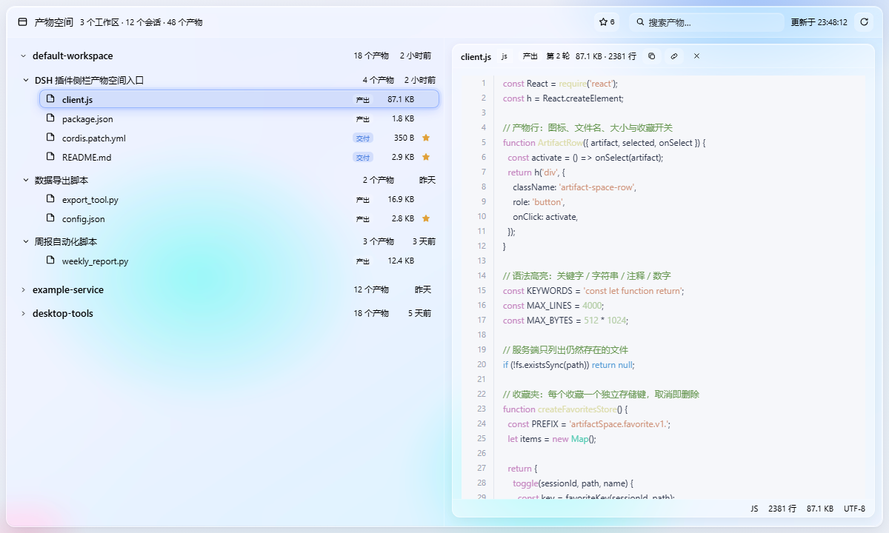

# Artifact Space（产物空间）

中文 | [English](README.en.md)

[](https://www.npmjs.com/package/@xxjxx/artifact-space)
[](./LICENSE)
[](https://github.com/topics/dsh-plugin)

一个为 DSH 增加**产物空间**侧栏入口的插件。它按「工作区 → 会话」两级列出每个会话最终产出的有效文件，支持直接预览内容。



## 功能

| | |
| --- | --- |
| **玻璃界面** | 分层玻璃面板，随明暗主题自适应；面板下方铺有彩色光斑，玻璃才真的有折射感，而不是一张淡色卡片 |
| **编辑器预览** | 代码文件以编辑器形态打开：行号栏随滚动吸附、语法高亮，底部状态栏显示语言、行数、体积与编码 |
| **多格式渲染** | Markdown、HTML、YAML、JSON 各有专属渲染器，图片直接显示，无法识别的格式一律回落到纯文本 |
| **三级搜索** | 工作区 / 会话 / 产物同时匹配；空格分隔的多个词是「备选」而非「收窄」，所以搜 `client json` 能同时找到 `client.js` 和 `package.json` |
| **收藏夹** | 把值得留意的产物标星，在收藏夹里集中查看。收藏可跨重启保留，**取消收藏即从磁盘删除对应记录** |
| **会话折叠** | 会话可折叠成标题行；默认只展开首屏能看到的那些 |
| **一键带走** | 在预览区头部直接复制文件内容或绝对路径 |
| **来源可溯** | 每个产物都标明是「交付」还是顺手「产出」、来自第几轮对话、会话当时对它说了什么 |

## 什么算是一个产物

宿主半边（Host half）折叠每个会话自己的日志事件，保留：

- 通过 `deliverables/presented` 声明的文件（类型 `presented`），
- 由成功的 `write`、`edit` 或 `str_replace_editor` 调用写入或修改的文件（类型 `produced`）。

只有**仍然存在**的文件才会被列出；没有任何存活产物的会话会被丢弃；会话与工作区都按最后活跃时间排序。

## 架构

| 半边 | 文件 | 职责 |
| --- | --- | --- |
| 宿主 | `index.js` | 注册两条需鉴权的路由：`GET /api/artifact-space.rows` 与 `GET /api/artifact-space.read` |
| 浏览器 | `client.js` | 注册侧栏入口（`sidebar.panellist`）与主面板（`main` slot，键为 `artifact-space`） |

两半边通过 `ctx.connection.fetch.register` 注册的鉴权宿主路由通信，凭证不会离开本机回环。

### 路由

- `GET /api/artifact-space.rows` — 所有工作区分组及其会话、产物。
- `GET /api/artifact-space.read?sessionId=…&path=…` — 单个产物的文本内容，上限 512 KB / 4000 行。拒绝原因映射为 `403 outside-workspace`、`404 not-a-file`、`413 too-large`、`415 binary-file`。

## 预览状态

`binary` 与 `outsideWorkspace` 在发起请求**之前**就根据行上的标记判定（不发请求、不闪加载态）。其余状态为 `missing`（404）、`error`（413 / 其它）以及渲染出的正文。

## 格式渲染

预览会按扩展名选择合适的呈现方式，而不是把原始文本直接甩出来：

| 扩展名 | 渲染方式 |
| --- | --- |
| `png`、`jpg`、`jpeg`、`gif`、`webp`、`bmp`、`avif`、`ico`、`svg` | 图片：宿主按扩展名对应的媒体类型返回原始字节，浏览器直接渲染，状态栏显示图片尺寸与体积 |
| `md`、`markdown`、`mdown`、`mkd`、`mdx` | Markdown：标题、段落、列表、表格、引用、分隔线、带语言标签的围栏代码块，以及行内代码 / 强调 / 删除线 / 链接 |
| `html`、`htm`、`xhtml` | 页面渲染：宿主把文档里用相对路径引用的图片、样式与字体改写成带会话鉴权的资源地址，在预览框里按真实页面呈现 |
| `yml`、`yaml` | 保留文档自身嵌套层级的缩进键值大纲 |
| `json`、`jsonc`、`json5` | 格式化的 JSON；文档损坏时回落到原始文本 |
| 其它 | 纯文本 |

任何格式都能回落到纯文本，所以无法识别或已损坏的文档照样能看到内容。

图片不走文本预览：宿主有一条独立的图片路由，只在文件位于所属工作区内、扩展名确属图片、
且体积在 16 MB 以内时才返回字节，并带上该扩展名对应的 `Content-Type`。
SVG 同样以图片方式呈现，浏览器不会执行其中的脚本。图片加载失败时预览区会如实说明原因。

图片预览区另提供两项操作：**全屏查看**会把图片放大到覆盖整个窗口，点击图片或预览区内的
「全屏查看」按钮均可触发，按 `Esc` 或点击遮罩关闭；**下载**从宿主图片路由取回字节并以
原始文件名存入本地，浏览器会弹出保存对话框。

全屏查看支持缩放：工具栏提供「放大 / 缩小 / 还原」按钮与实时比例读数，范围 20%–800%；
鼠标滚轮可直接缩放，`+` 放大、`-` 缩小、`0` 还原。图片以 `transform` 缩放，原始分辨率
不受影响，放大后可用抓手光标查看局部细节。

HTML 产物走的是另一条路：宿主把文档原样投递，但先把文档里的 `src`、`href`、`poster`、
`srcset` 等相对引用改写成资源地址——绝对地址、`data:` URI 与纯锚点一律保持原样，
用 `..` 爬出工作区根的引用会被拒绝。预览框加载的是页面本身，因此文档中的相对图片
能够正常呈现；「在浏览器中打开」按钮可将文档置于独立标签页中查看。
文档由宿主投递时带 `content-security-policy`，禁止内联脚本与外网访问，预览框的
`sandbox` 进一步收敛权限，文档里的脚本不会执行。

代码文件（`js`、`ts`、`py`、`json`、`yml` 等）以编辑器形态打开：吸附式行号栏、语法高亮，以及报告语言、行数、体积与编码的状态栏。

## 产物来源

宿主为每个产物从会话日志里折出三项事实，面板会展示它们：

- **交付** 或 **产出** —— 会话明确交付给用户的文件标记为「交付」，其余标记为「产出」。
- **轮次** —— 这次交付来自对话的第几轮。
- **说明** —— 会话当时对这个文件说了什么。

列表行只带徽章，好让文件名保留自己的空间；预览区头部则完整展示轮次与说明。

## 把产物带走

预览区头部提供**复制内容**与**复制路径**。复制优先走异步 Clipboard API，宿主不支持时（缺少该 API、权限被拒）回退到隐藏 textarea 加 `execCommand('copy')` —— 与宿主自身的原语顺序一致。剪贴板拒绝写入时，按钮会如实显示失败，而不是假装成功。

二进制文件与工作区之外的文件没有内容可复制，但路径仍然可以复制。

## 查找产物

- **搜索**跨三个层级过滤 —— 工作区、会话、产物。空格分隔的多个词是备选而非收窄，所以 `client json` 既能找到 `client.js` 也能找到 `package.json`。命中的词会高亮，搜索框旁显示结果数，`Ctrl`/`Cmd`+`F` 可聚焦。
- **折叠**把会话收成标题行。默认只展开首屏放得下的会话；被手动折叠或展开的会话会记住那个选择。

## 收藏夹

产物行上的星标即可收藏，收藏项汇总在**收藏夹**视图里（头部那个星标按钮）。

- 收藏以「所属会话 + 路径」为键，因为两个会话可能产出同名路径，而那是不同的产物。
- 收藏通过 `localStorage` 跨重启保留 —— 与宿主自己的客户端 store 用的是同一条通道。每条收藏各占一个键，所以取消收藏会直接删掉那个键，磁盘上不留任何东西。存储不可用时（隐私窗口、配额已满），功能降级为仅本次会话有效，而不是报错。
- 收藏的生命周期可以比会话长。所属会话被删除后，该条目会被标记为失效且无法打开；收藏夹头部的**清理 N 项失效**按钮会删除这些条目，并同步删掉它们的存储记录。
- 失效条目**绝不自动清理**：宿主会在会话日志不可读或等待迁移时把该行整个丢掉，所以「列表里没有」并不能证明「文件已删除」，据此自动清扫会误删用户仍想要的收藏。

## 安装

### 从插件市场安装

打开 **Settings → Plugins → Discover**，搜索 *Artifact Space* 并安装。市场会安装索引中指定的确切版本，并通过 profile 补丁启用它。

本插件已被以下公开目录收录：

| 目录 | 位置 | 状态 |
| --- | --- | --- |
| 官方插件市场（`awesome-dsh-plugin` registry） | [awesome-dsh-plugin.com](https://awesome-dsh-plugin.com) · DSH 内置的「插件市场」插件读的就是它 | 收录 PR 已提交 |
| 1024 社区插件目录 | [deepseek1024.com](https://deepseek1024.com) | 已收录并同步上线 |
| 社区插件精选 | [kejixiaoliang/awesome-dsh-plugins](https://github.com/kejixiaoliang/awesome-dsh-plugins) | 收录 PR 已提交 |

官方目录每日构建一次，合并后约一天内自动出现在 DSH 内置市场的搜索结果里。

### 从 registry 安装

```bash
npm install @xxjxx/artifact-space
```

或者直接用 DSH 的命令：

```bash
dsh plugin add @xxjxx/artifact-space
```

然后在自己的 profile 补丁（`~/.dsh/profiles/desktop/cordis.patch.yml`）中启用：

```yaml
- insert:
    - id: artifact-space
      name: 'artifact-space'
```

### 环境要求

- DSH `>= 0.1.5-alpha.2` —— 插件在 `engines.dsh` 中声明了该范围，运行版本不满足时宿主会拒绝加载。
- **不使用任何宿主私有 API**。插件只通过公开的 `ctx.connection.fetch` 路由通信，收藏持久化在 `localStorage` 里。

浏览器半边通过 `dsh-client-hmr` 热重载；改动宿主半边则需要重新启用插件（或重启应用），以便模块被重新导入。

## 隐私

插件只读取宿主本就已开放给它的会话日志与工作区文件。它不发起任何自己的网络请求，也不向任何地方发送数据。

收藏保存在浏览器本地 profile 下，键名前缀为 `artifactSpace.favorite.v1.*`。取消收藏会删除对应条目，收藏夹头部的**清空**按钮会连同它们的存储记录一起删除全部收藏。

## 许可证

MIT —— 见 [LICENSE](./LICENSE)。
